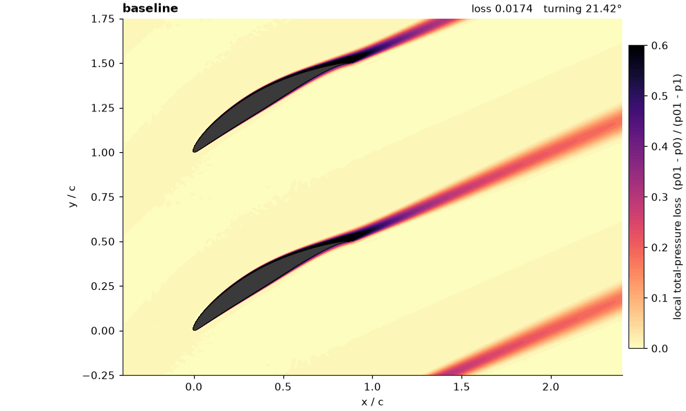
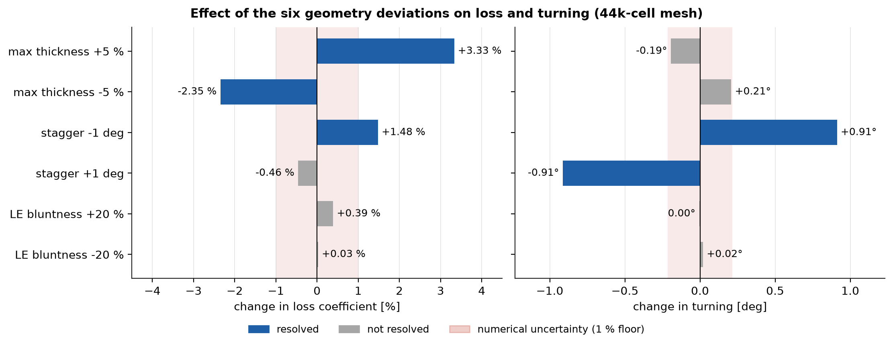
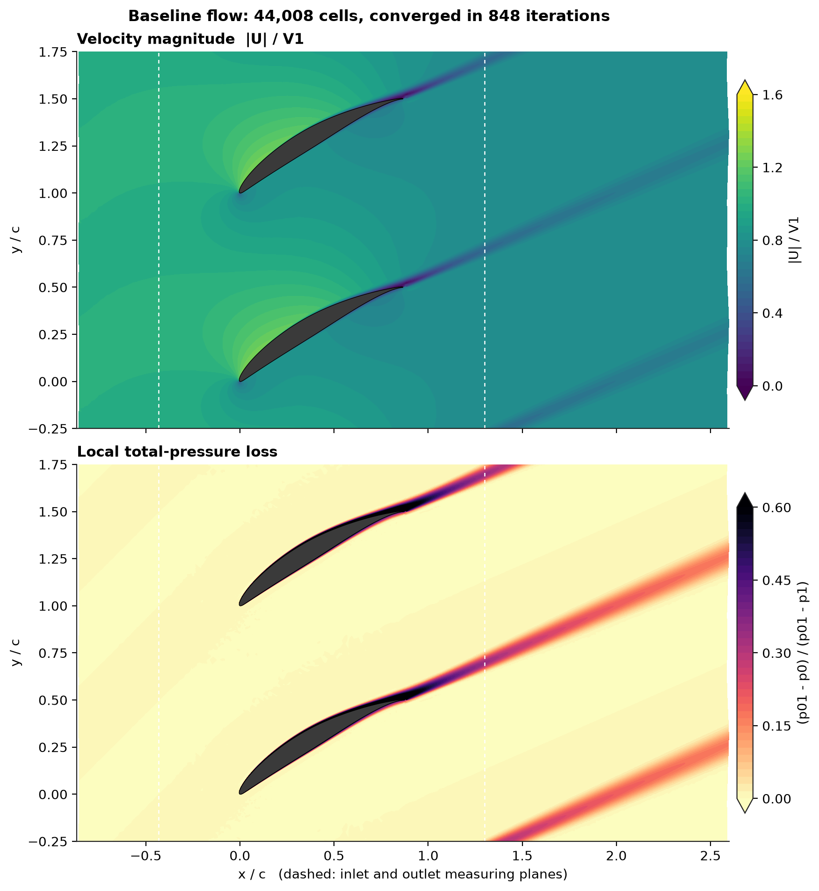
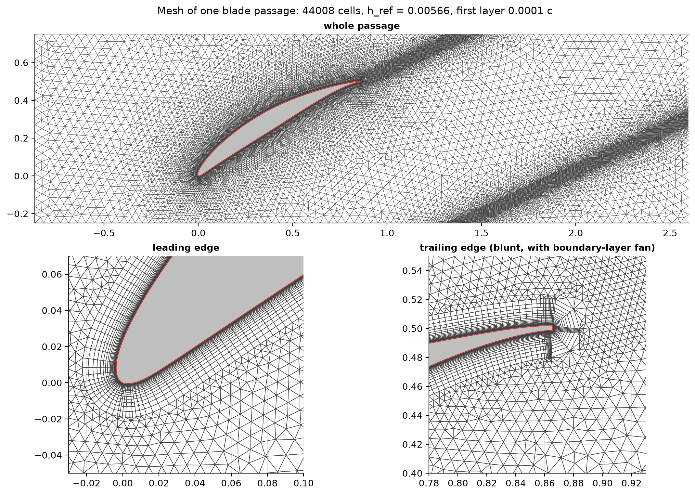
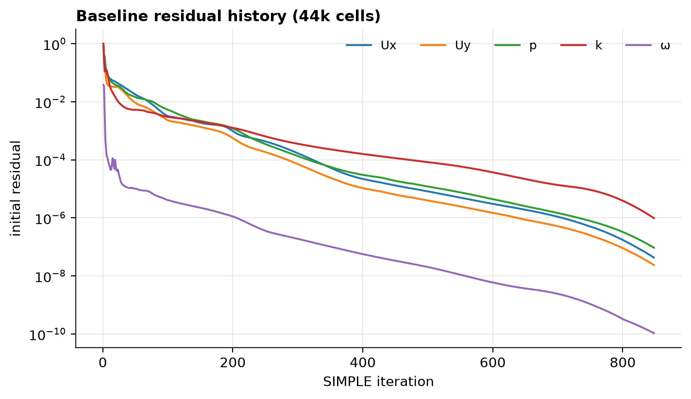
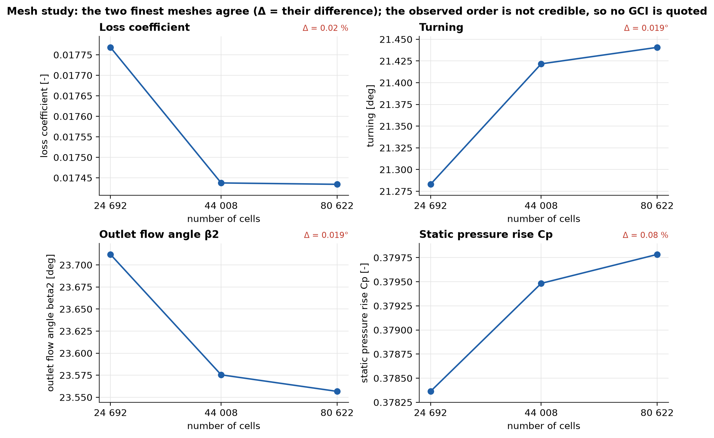

# How much do small blade deviations change the loss of a compressor cascade?

**A 2D RANS study of a NACA 65-(12)10 compressor cascade in OpenFOAM (ESI v2606), with Gmsh meshing and Python post-processing.**

> Made with AI assistance



*Flip-book through the seven finished cases (baseline, thickness ∓5 %, stagger ∓1°, leading-edge bluntness ∓20 %). The
solver is steady, so this is a comparison of cases, not a time sequence. Colour = local total-pressure loss; the title of
each frame gives the loss and the turning of that case.*

## The question
In a compressor, blades are never exactly the designed shape. I take one blade, change **one thing at a time** by a small
amount, and ask: how much do the **loss** (total-pressure loss coefficient) and the **turning** (how much the blade
turns the flow) change, and is the change larger than my numerical error?

| deviation | size |
|---|---|
| leading-edge bluntness | -20 % / +20 % |
| maximum thickness | -5 % / +5 % |
| stagger angle | -1° / +1° |

## What I found (44k-cell mesh, all cases converged)

| deviation | change in loss | change in turning | resolved? |
|---|---|---|---|
| thickness +5 % | **+3.3 %** | -0.19° | loss yes, turning no |
| thickness -5 % | **-2.3 %** | +0.21° | loss yes, turning no |
| stagger -1° | **+1.5 %** | **+0.91°** | both yes |
| stagger +1° | -0.5 % | **-0.91°** | turning yes, loss no |
| LE bluntness +20 % | +0.4 % | -0.005° | **not resolved** |
| LE bluntness -20 % | +0.03 % | +0.02° | **not resolved** |

* **Stagger moves the turning, thickness moves the loss.** A 1° stagger change changes the outlet angle by almost exactly
  1° (as it should). A 5 % thickness change changes the loss by 2 to 3 %.
* **Leading-edge bluntness of ±20 % has no effect I can resolve.** Its effect on loss is below my 1 % noise floor. I
  report it as "not resolved", not as "no effect".
* "Resolved" means the change is larger than a 1 % mesh-noise floor on the baseline value (the GCI of the finest meshes is
  far smaller than that, see the mesh study).



*Blue = larger than the numerical uncertainty, grey = not resolved. Red band = uncertainty.*

## The baseline flow

| quantity | value |
|---|---|
| loss coefficient (flux-averaged) | 0.01744 |
| turning | 21.42° (Carter's rule: 22.29°) |
| outlet flow angle β2 | 23.58° |
| diffusion factor | 0.423 |
| static pressure rise coefficient | 0.379 |
| out/in mass flow | 0.99999 |
| y+ on the blade | min 0.013, mean 0.53, max 1.70 |



The flow is smooth and attached, the wake is thin and leaves along the blade-exit direction, and I see no reversed flow at
the periodic boundaries. (The thin white line in the plots is a plotting seam between the two drawn passages.)

## How it works

```
configs/base.json ──► geometry.py ──► mesh.py (Gmsh) ──► gmshToFoam ──► createPatch (periodic) ──► checkMesh
                                                                                                      │
 deviation_sweep.py / mesh_study.py ◄── metrics.json ◄── postproc.py ◄── simpleFoam (k-omega SST) ◄───┘
```

* **Geometry**: NACA 65-010 thickness on an a = 1.0 mean line with design lift coefficient 1.2 (camber 30.4°), stagger
  30°, solidity 1.0, 45° inflow. I chose this blade because it is the one in the NACA low-speed cascade tests
  (RM L51G31 / Report 1368), so there is a published point to compare with.
* **Domain**: one blade passage, periodic top and bottom, one cell thick in z (OpenFOAM's way to run 2D). The domain is
  made from the nominal blade, so all seven geometries use the same box.
* **Flow**: incompressible, Re = 2.45e5 (the standard NACA test value), inlet 45°, 1 % turbulence intensity, viscosity ratio
  10, outlet at fixed pressure. Steady `simpleFoam`, SIMPLEC, k-ω SST, linearUpwind for velocity, upwind for k and ω.
* **Mesh**: Gmsh, quad boundary layer on the blade (first layer 1e-4 c), triangles elsewhere, refined along the expected
  wake line.



### Why I chose these settings
* **Periodic passage, not a single blade**: a cascade is a row of identical blades. Periodic boundaries give the
  blade-to-blade interaction for the cost of one blade. The assumption is that every passage is identical (no
  rotor-stator effects, no end walls).
* **k-ω SST with low-Re wall treatment**: it handles adverse pressure gradients on the suction side better than plain
  k-ε and it can be run down to y+ about 1. I keep the first layer so that y+ stays below 2 (measured: mean 0.5).
  Its limits are that it cannot predict laminar-turbulent transition (the real blade has laminar separation at this
  Re) and it is only moderately reliable in separated flow and corner flows. I do not hide this: see limitations.
* **Loss at planes half a chord from the blade, flux-averaged**: close enough to be meaningful, far enough for the wake
  to have formed. Flux-averaging is simple; mixed-out averaging would give a somewhat different loss.
* **One change at a time**: the only way to attribute an effect to a cause.
* **A 1 % noise floor for "resolved"**: a result smaller than the numerical error of the mesh is not a result.
* **Everything in Python, ASCII output**: the post-processing reads the OpenFOAM fields itself, so it needs no ParaView
  and no OpenFOAM function objects.

### Convergence


All 10 production cases stopped on the residual criterion (p 1e-5, U 5e-6, k and ω 1e-6). I also checked that
tightening the residuals to 1e-8 changes the loss only in the 6th digit, so iteration error is not a concern.

## Mesh study (verification)

I first ran three meshes of 14k / 25k / 44k cells. **No GCI could be computed**: the loss kept falling by about 3.3e-4 per
step (1.9 %) and the turning was non-monotonic. I ran five meshes (8.6k to 80k cells), repeated them with a different
velocity-gradient limiter and with tighter residuals, and got the same pattern. So it is not iteration error and not the
limiter; I did not identify the cause. The data say that the 14k and 25k meshes are not yet in the asymptotic range, and
that 44k and 80k agree.

| h_ref | cells | loss | turning [°] | β2 [°] |
|---|---|---|---|---|
| 0.0160 | 8.6k | 0.018410 | 21.417 | 23.585 |
| 0.0113 | 14.4k | 0.018094 | 21.295 | 23.700 |
| 0.0080 | 24.7k | 0.017768 | 21.283 | 23.712 |
| **0.00566** (used for the sweep) | **44.0k** | **0.017438** | **21.422** | **23.575** |
| 0.0040 | 80.6k | 0.017434 | 21.441 | 23.557 |

(The 8.6k row comes from a run with residuals tightened to 1e-8, the other rows from the standard-residual runs. Where I
compared both (14.4k, 25k, 44k, 80k cells) the loss differed by less than 5e-7. The unlimited-gradient repeat was made in a
scratch copy and is not stored in the repository.)



*The script prints an observed order of 16 for the loss and about 7 for turning, and a GCI close to zero. These are not
credible for a second-order scheme: the values are a plateau, not a convergence order. **I do not quote the GCI.** The
error bound I use is the difference between the 44k and 80k meshes: 0.02 % in loss and 0.02° in turning and β2.* The first
study is kept in `results/mesh_study_prev_14k-25k-44k/`. A sweep I ran earlier on the 25k mesh (not kept) gave the same
resolved / not resolved pattern.

The mesh study scales only the outer and tangential sizes; the wall-normal resolution is fixed.

## Comparison with the NACA tests: one point, read off a plot (NOT a validation)
I have one data point for the same blade (σ = 1.0, β1 = 45°) that I **read off a plot** of RM L51G31 Fig. 30(g); the loss is a
conversion from the reported drag coefficient. Derivation and uncertainty: `data/benchmark_notes.md`.

| quantity | CFD (44k) | NACA point | difference |
|---|---|---|---|
| turning | 21.42° | 22.2° (±0.3°) | -3.5 % |
| loss | 0.0174 | 0.0167 (±0.0006 in Cd, plus the conversion) | +4.4 % |

I do not call this validated. The agreement may be partly luck: the experiment had laminar separation and my model is fully
turbulent, the wake rake in the tests was about 1 chord downstream (mine: 0.5 axial chord), the tested blades used a
slightly different thickness form, the tunnel had porous walls and finite span, and my loss is flux-averaged. The other
checks I did are Carter's rule (my turning is 0.9° lower) and mass conservation (1e-5).

## Honest status and limitations
* **Not validated.** One plot-read point is a sanity check, not a validation. Validation against tabulated data of the
  report is future work.
* **Baseline versus an earlier run of this setup on OpenFOAM v1912** (loss 0.0219, turning 19.93°): mine is 20 % lower in loss and 7 % higher in
  turning. That reference was produced with a thickness table that has since been corrected, and on another OpenFOAM
  version; I did not isolate which of the two causes the difference.
* **2D, steady, fully turbulent, incompressible.** No transition model, no 3D effects (end walls, tip leakage), no
  compressibility, no unsteadiness.
* **Mesh quality**: checkMesh passes, but the maximum non-orthogonality is 50° to 60° on the 25k and 44k meshes and 84° on
  the 80k mesh. The unstructured Gmsh meshes around the very thin trailing edge are the weak spot.
* **The mesh-study cause is not understood** (see above), and its wall-normal resolution is not varied.
* **Losses are flux-averaged**, not mixed-out.
* **Blunt trailing edge**: I add 0.0015 c half thickness at the trailing edge for meshing robustness.
* **Assumptions**: camber = 25.3° × cl0 (only labels the incidence), 1 % inlet turbulence, viscosity ratio 10.
* The tested blades used the "65(216)-010 combined" thickness form; to use it set
  `blade.table = data/naca65_216_010_combined_thickness.csv` and `blade.te_half_thickness = 0` (e.g. via `--set`).
* The thickness table `data/naca65_010_thickness.csv` is **verified** against the PDAS recomputation of the Abbott & von
  Doenhoff tables and against NACA RM L51G31 Table I (agree within 0.0074 % chord).

## Run it
```
python3 -m venv .venv && .venv/bin/pip install -r requirements.txt   # Linux: sudo apt install libglu1-mesa
source env.sh                      # loads OpenFOAM v2606 (if needed) and the venv
python3 scripts/check_setup.py     # must end with ALL CHECKS PASSED

python3 scripts/run_case.py configs/base.json --case runs/base
python3 scripts/plot_fields.py runs/base --out results/fields_base.png
python3 scripts/mesh_study.py configs/base.json --out results/mesh_study --h-ref 0.008 0.00566 0.004
python3 scripts/deviation_sweep.py configs/base.json --out results/deviation_sweep --set mesh.h_ref=0.00566
python3 scripts/compare_benchmark.py runs/deviation_sweep_fine/base
python3 scripts/make_media.py --sweep runs/deviation_sweep_fine --out results/media    # pictures + GIF of this README
```
`./Allrun` does check + baseline + plot, `./Allclean` removes `runs/`. Useful options: `--set section.key=value`,
`--jobs N` (parallel cases), `--reuse`, `--max-iter N`. `runs/` is git-ignored.

## Changes I had to make for v2606 (relative to my first setup on v1912)
1. `grad(U)` uses `cellMDLimited` instead of `cellLimited`: with `cellLimited` the residuals froze at 1e-5 to 1e-4 and never
   met the criterion; `cellMDLimited` (and unlimited `Gauss linear`) converge in about 600 iterations.
2. k/ω relaxation 0.7 instead of 0.9 (stalled residuals at 0.9 on an earlier geometry); U stays 0.9.
3. `gmshToFoam` cellZone `fluid` is deleted: it makes `simpleFoam -dry-run` abort on v2606.
4. The blade patch is set to type `wall` (required by wall functions).
5. y+ is taken with `simpleFoam -postProcess -func yPlus`; the standalone `postProcess -func yPlus` returns 0.
6. Gmsh occasionally fails ("Edge not recovered"); `mesh.py` retries with a thinner boundary layer and reports the fallback
   (all 10 production cases meshed on the first attempt). Do not remove the trailing-edge-face boundary layer
   (`mesh.bl_on_te_face=false` produced meshes that fail checkMesh).

## Layout
`cascade/` (geometry, mesh, case, foam, foamio, postproc, gci, runner), `scripts/`, `configs/base.json`,
`case_template/` (`@NAME@` placeholders), `data/`, `results/` (figures, tables and `media/`), `runs/` (git-ignored).
The script and module docstrings explain why I made each choice.

## Future work
Validation against tabulated NACA data, mixed-out averaging, a transition model, a wall-normal mesh study, a study of what
makes the 14k and 25k meshes pre-asymptotic, 3D effects.
